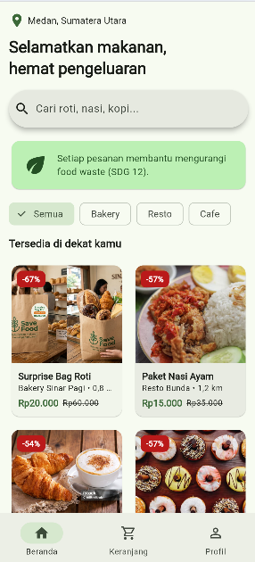
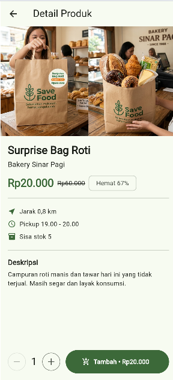
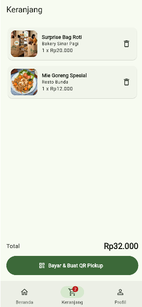
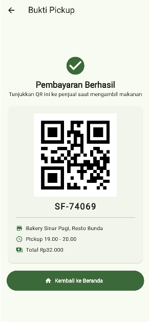
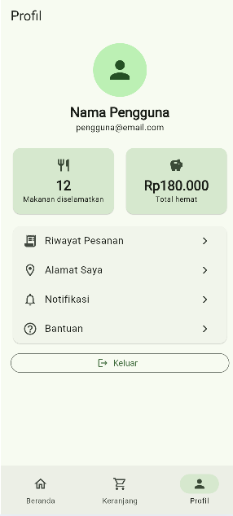

# Save Food 🌱

Aplikasi mobile untuk mengurangi pemborosan makanan dengan menghubungkan bisnis makanan dan konsumen.

**Kelompok:** Daydreamers

**Anggota:**
- Victoria Lusiana Manullang
- Siska Clarissa
- Riyanti Teresa
- Eka Anastasya Situmorang

**SDGs:** SDG 12 – Responsible Consumption and Production

---

## Progress Pertemuan 1–5

### 1. Beranda

**Widget yang diterapkan:**
- `CustomScrollView` dan `SliverGrid` untuk layout scroll dan grid produk yang responsif
- `SearchBar` untuk kolom pencarian makanan
- `ChoiceChip` dan `Wrap` untuk filter kategori (Semua, Bakery, Resto, Cafe)
- `Card` untuk banner dampak SDG 12 dan kartu produk

### 2. Detail Produk

**Widget yang diterapkan:**
- `ListView` dan `AspectRatio` untuk foto dan isi halaman yang bisa di-scroll
- `Chip` untuk label persentase hemat
- `IconButton.outlined` untuk pengatur jumlah pesanan
- `Divider` untuk memisahkan bagian informasi
- `ConstrainedBox` untuk membatasi lebar konten di layar besar

### 3. Keranjang / Checkout

**Widget yang diterapkan:**
- `ListenableBuilder` agar daftar dan total otomatis ter-update
- `ListView.separated` untuk daftar item pesanan
- `Card` dan `Row`/`Column` untuk susunan tiap item
- `Badge` pada ikon navigasi untuk jumlah item

### 4. QR Code / Bukti Pickup

**Widget yang diterapkan:**
- `QrImageView` (package `qr_flutter`) untuk menampilkan QR bukti pengambilan
- `Card` untuk membungkus detail pesanan
- `SingleChildScrollView` agar halaman aman di layar kecil

### 5. Profil Pengguna

**Widget yang diterapkan:**
- `CircleAvatar` untuk foto profil
- `StatTile` (widget buatan sendiri) untuk statistik makanan diselamatkan dan total hemat
- `ListTile` untuk daftar menu
- `OutlinedButton` untuk tombol keluar

### Screen berikutnya (rencana)
Login/Register, Pencarian & Filter, dan Riwayat Pesanan akan dikerjakan pada pertemuan berikutnya.

---

## Penerapan Materi

- **Material Design 3:** `ThemeData(useMaterial3: true)` dengan `ColorScheme.fromSeed`, serta `NavigationBar`
- **Reusable widget:** `ProductCard`, `ProductImage`, `PrimaryButton`, `InfoRow`, `StatTile`
- **Asset:** foto produk di `assets/images/` (dengan ikon pengganti jika file tidak ditemukan)
- **Responsive UI:** `SliverGridDelegateWithMaxCrossAxisExtent` dan `ConstrainedBox(maxWidth)`

## Catatan

- Data produk dan statistik profil masih berupa data dummy.
- Pencarian, Login/Register, dan Riwayat Pesanan akan dikerjakan pada pertemuan berikutnya.

## Cara menjalankan
flutter pub get
flutter run -d chrome